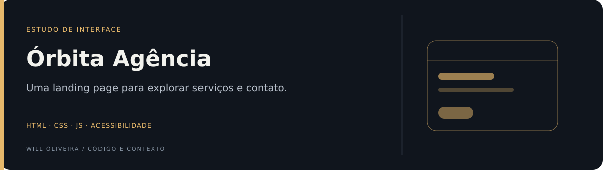
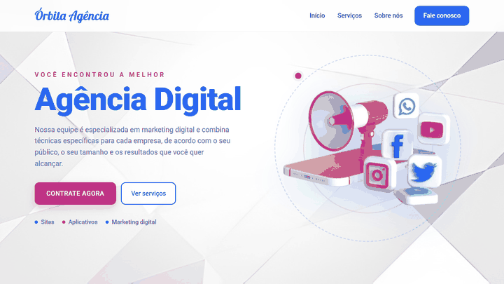

<p align="center">
  
</p>

# Órbita Agência · landing page

Landing page de uma agência digital fictícia, com apresentação de serviços e chamada para contato. Revisada para ser acessível e responsiva de verdade.

**HTML · CSS · JavaScript** · [Ver online](https://will-ifes.github.io/orbita-agencia/)

<p align="center">
  
</p>

## O que mudou na revisão

| Antes | Depois |
| --- | --- |
| Menu sumia abaixo de 1005px, sem alternativa | Botão "Menu" com `aria-expanded`, fecha com Esc ou ao escolher um link |
| Título de 80px estourava a tela no celular | Tamanho fluido com `clamp()`, sem rolagem horizontal de 375px a 1366px |
| Texto extra dos cards só aparecia com o mouse por cima | Botão "Vamos fazer uma parceria?" funciona com teclado, toque e leitor de tela |
| Dois `h1`, `div`s genéricos e links para `#` | Landmarks (`header`, `nav`, `main`, `footer`), um `h1`, links para as seções reais |
| Parágrafo em `#339ff8` (2.8:1) e branco sobre rosa (3.9:1) | Texto escuro e rosa ajustado para `#b8338f`, todos acima de 4.5:1 |
| Sem foco visível nem atalho de teclado | Contorno de foco em todos os controles e link "Pular para o conteúdo" |
| Erros de digitação ("HTMS", "revervados", "estremamente") | Textos revisados e nova seção "Sobre nós" e "Fale conosco" |
| Dois arquivos CSS (`reponsivo.css`) e imagem de fundo distorcida | Um `style.css` com tokens de cor e fundo com `cover` |

O efeito original foi mantido: o card aberto fica rosa com texto branco. O movimento é desligado quando o sistema pede `prefers-reduced-motion`.

**Validação:** axe-core sem violações, com menu e cards abertos. Conferido em 375px, 768px e 1366px.

## Por dentro do código

| Arquivo | Responsabilidade |
| --- | --- |
| [`index.html`](index.html) | Estrutura semântica e conteúdo. |
| [`style.css`](style.css) | Tokens, layout em grid, estados de foco e o breakpoint de 900px. |
| [`script.js`](script.js) | Menu do celular e abertura dos cards. |

## Executar localmente

Não há dependências nem build. Com Python 3:

```bash
git clone https://github.com/Will-Ifes/orbita-agencia.git
cd orbita-agencia
python -m http.server 8080
```

Abra http://localhost:8080.

## Escopo

A agência é fictícia. O e-mail de contato usa o domínio reservado `orbita.example` e não há backend.

---

Mantido por **Will Oliveira** · [Perfil](https://github.com/Will-Ifes) · [LinkedIn](https://www.linkedin.com/in/wildemberg-de-jesus-oliveira/)
